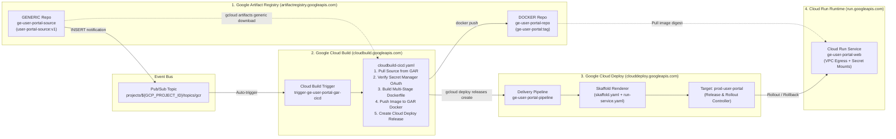

# GCP Production Deployment Guide: Gemini AI Hub — User Portal

This deployment guide walks through deploying the standalone **Gemini AI Hub — User Portal** (`user-portal/frontend/` + `user-portal/backend/` + `geapphub_user` PostgreSQL database) to Google Cloud Platform using **Google Artifact Registry**, **Cloud Build**, **Google Cloud Secret Manager**, and **Terraform**.

> **End-to-End Pipeline with Google Artifact Registry, OAuth Secret & SSL Certificate ID**: Container images are built and pushed directly to **Google Artifact Registry** (`${GCP_REGION}-docker.pkg.dev/${GCP_PROJECT_ID}/${AR_REPO}`). OAuth credentials (`client_id` + `client_secret`) are stored in **Google Cloud Secret Manager** (`ge-oauth-credentials`), and the Regional Internal HTTPS Application Load Balancer attaches your pre-created **Compute SSL Certificate ID** (`SSL_CERTIFICATE_ID`).

---

## 1. Directory Structure (`user-portal/`)

```text
user-portal/
├── Dockerfile                              # Multi-stage container build (frontend/ + backend/)
├── cloudbuild.yaml                         # 4-stage Cloud Build CI pipeline for Artifact Registry
├── frontend/                               # React 18 + TypeScript + Vite User Portal SPA
├── backend/                                # FastAPI User Portal Backend (Port 8080, geapphub_user DB)
├── deploy/
│   ├── config.env.example                  # GCP, Artifact Registry, OAuth Secret & SSL Cert ID template
│   ├── deploy_user_portal_gcp.sh           # 4-stage automated pipeline orchestrator script
│   ├── clouddeploy/                        # GCP-native CI/CD manifests (GAR + Cloud Build + Cloud Deploy)
│   │   ├── cloudbuild-cicd.yaml            # End-to-end CI/CD build config (GAR -> Cloud Build -> Cloud Deploy)
│   │   ├── clouddeploy.yaml                # DeliveryPipeline (ge-user-portal-pipeline) & Target (prod-user-portal)
│   │   ├── skaffold.yaml                   # Skaffold v4beta7 configuration for Cloud Run rendering
│   │   └── run-service.yaml                # Declarative Cloud Run v2 Knative Service manifest
│   └── terraform/                          # Terraform stack (VPC, PSA, Cloud SQL HA, Secrets, Run, HTTPS ILB)
│       ├── versions.tf                     # google and google-beta providers
│       ├── variables.tf                    # Parameterized inputs (oauth_secret_name, ssl_certificate_id)
│       ├── main.tf                         # APIs, VPC, AR, Cloud SQL HA, Secret Manager, Run, HTTPS ILB
│       └── outputs.tf                      # Artifact Registry URI, ILB VIP, SSL Cert ID, Cloud Run URL
└── docs/
    ├── USER_PORTAL_GCP_DEPLOYMENT_GUIDE.md # This deployment guide
    └── user-portal-gcp-deployment-design.md # Architecture & security specification
```

---

## 2. Manual Prerequisites (Clone Repository, Create OAuth Secret & Create SSL Certificate)

### Step 1: Clone the GitHub Repository
Clone the repository to your workstation or Cloud Shell:

```bash
git clone https://github.com/<YOUR_GITHUB_ORG_OR_USER>/<YOUR_GITHUB_REPO>.git
cd <YOUR_GITHUB_REPO>
```

### Step 2: Manually Create Google OAuth 2.0 Web Client Credentials
1. Open **Google Cloud Console -> APIs & Services -> OAuth consent screen** (`https://console.cloud.google.com/apis/credentials/consent?project=<YOUR_GCP_PROJECT_ID>`):
   - Select **Internal** user type (for Google Workspace / Cloud Identity enterprise users) and click **Create**.
   - Enter the **App name** (e.g., `Gemini AI Hub — User Portal`), **User support email**, and **Developer contact information**, then click **Save and Continue**.
2. Open **Google Cloud Console -> APIs & Services -> Credentials** (`https://console.cloud.google.com/apis/credentials?project=<YOUR_GCP_PROJECT_ID>`).
3. Click **+ Create Credentials -> OAuth client ID**:
   - **Application type**: `Web application`
   - **Name**: `ge-user-portal-web-client`
   - **Authorized JavaScript origins**:
     - `https://<YOUR_INTERNAL_DOMAIN_NAME>` (e.g., `https://aihub.internal.corp`)
   - **Authorized redirect URIs**:
     - `https://<YOUR_INTERNAL_DOMAIN_NAME>/api/v1/auth/google/callback` (e.g., `https://aihub.internal.corp/api/v1/auth/google/callback`)
4. Click **Create** and either click **Download JSON** (`client_secret_*.json`) or copy the **Client ID** (`*.apps.googleusercontent.com`) and **Client Secret** (`GOCSPX-*`).

### Step 3: Store OAuth Credentials (`ge-oauth-credentials`) in Google Cloud Secret Manager
Store both the OAuth 2.0 Client ID and Client Secret in a single JSON secret (`ge-oauth-credentials`) in **Google Cloud Secret Manager**:

#### Option 3A: Store `ge-oauth-credentials` via `gcloud` CLI
```bash
export GCP_PROJECT_ID="<YOUR_GCP_PROJECT_ID>"
gcloud services enable secretmanager.googleapis.com --project="${GCP_PROJECT_ID}"

gcloud secrets describe ge-oauth-credentials --project="${GCP_PROJECT_ID}" >/dev/null 2>&1 || \
  gcloud secrets create ge-oauth-credentials --replication-policy="automatic" --project="${GCP_PROJECT_ID}"

printf '{"client_id":"%s","client_secret":"%s"}' \
  "<YOUR_OAUTH_CLIENT_ID>.apps.googleusercontent.com" \
  "<YOUR_OAUTH_CLIENT_SECRET>" | \
  gcloud secrets versions add ge-oauth-credentials --data-file=- --project="${GCP_PROJECT_ID}"
```

#### Option 3B: Store `ge-oauth-credentials` via Google Cloud Console UI
1. Open **Google Cloud Console -> Security -> Secret Manager** (`https://console.cloud.google.com/security/secret-manager?project=<YOUR_GCP_PROJECT_ID>`).
2. Click **+ Create Secret**:
   - **Name**: `ge-oauth-credentials`
   - **Secret value**: Upload the downloaded OAuth `client_secret_*.json` file (or paste `{"client_id":"<CLIENT_ID>","client_secret":"<CLIENT_SECRET>"}`) -> Click **Create Secret**.

### Step 4: Create the Regional Compute SSL Certificate (`SSL_CERTIFICATE_ID`)
Create a regional SSL certificate in `${GCP_REGION}` for your internal DNS name and note its `SSL_CERTIFICATE_ID`:

```bash
export GCP_PROJECT_ID="<YOUR_GCP_PROJECT_ID>"
export GCP_REGION="us-central1"
export INTERNAL_DOMAIN_NAME="aihub.internal.corp"

# (Optional) Generate certificate & private key if you do not already have portal.crt and portal.key
openssl req -x509 -nodes -newkey rsa:2048 -days 365 \
  -keyout portal.key \
  -out portal.crt \
  -subj "/CN=${INTERNAL_DOMAIN_NAME}" \
  -addext "subjectAltName=DNS:${INTERNAL_DOMAIN_NAME}"

# Create the regional SSL certificate in Google Cloud
gcloud compute ssl-certificates create cert-ge-user-portal-internal \
  --certificate=portal.crt \
  --private-key=portal.key \
  --region="${GCP_REGION}" \
  --project="${GCP_PROJECT_ID}"

export SSL_CERTIFICATE_ID="projects/${GCP_PROJECT_ID}/regions/${GCP_REGION}/sslCertificates/cert-ge-user-portal-internal"
```

### Step 5: Configure `user-portal/deploy/config.env`
Copy [`user-portal/deploy/config.env.example`](../deploy/config.env.example) to `user-portal/deploy/config.env`:

```bash
cp user-portal/deploy/config.env.example user-portal/deploy/config.env
```

Edit `user-portal/deploy/config.env`:
```bash
# 1. Target Google Cloud Project, Organization ID & Region (Required)
export GCP_PROJECT_ID="<YOUR_GCP_PROJECT_ID>"
export GCP_ORG_ID="<YOUR_GCP_ORGANIZATION_ID>"
export GCP_REGION="us-central1"

# 2. Google Artifact Registry Source (GENERIC) & Image (DOCKER) Settings
export AR_SOURCE_REPO="ge-user-portal-source"
export SOURCE_PACKAGE="user-portal-source"
export SOURCE_VERSION="v1"
export AR_REPO="ge-user-portal-repo"
export IMAGE_NAME="ge-user-portal"
export IMAGE_TAG="latest"

# 3. Cloud Secret Manager Secret ID (OAuth JSON) & Regional SSL Certificate ID
export OAUTH_SECRET="ge-oauth-credentials"
export SSL_CERTIFICATE_ID="projects/${GCP_PROJECT_ID}/regions/${GCP_REGION}/sslCertificates/cert-ge-user-portal-internal"

# 4. Internal Domain Name
export INTERNAL_DOMAIN_NAME="aihub.internal.corp"
```

### Step 6: Authenticate `gcloud` and Application Default Credentials (ADC)
```bash
source user-portal/deploy/config.env
gcloud auth login
gcloud auth application-default login
gcloud config set project "${GCP_PROJECT_ID}"
```

---

## 3. Option A: 1-Command End-to-End Pipeline (`deploy_user_portal_gcp.sh`)

Run [`user-portal/deploy/deploy_user_portal_gcp.sh`](../deploy/deploy_user_portal_gcp.sh) from the repository root. It executes the 4-stage deployment pipeline:
1. **Stage 1**: Enables APIs, creates the **Google Artifact Registry** `GENERIC` source repository (`ge-user-portal-source`) and `DOCKER` image repository (`ge-user-portal-repo`), and grants Cloud Build IAM permissions.
2. **Stage 2**: Ensures `ge-oauth-credentials` exists and has an active version in **Cloud Secret Manager**.
3. **Stage 3**: Packages `user-portal/` and uploads it to the **Google Artifact Registry** `GENERIC` repository (`gcloud artifacts generic upload`), then runs the **Cloud Build** pipeline ([`user-portal/cloudbuild.yaml`](../cloudbuild.yaml)) with `--no-source` (which downloads the source from Artifact Registry, verifies `ge-oauth-credentials` from Cloud Secret Manager, builds `user-portal/Dockerfile`, and pushes the image to the Artifact Registry `DOCKER` repository).
4. **Stage 4**: Runs **Terraform** (`user-portal/deploy/terraform/`), attaching `${SSL_CERTIFICATE_ID}` to the Regional Internal HTTPS Load Balancer (`proxy-ge-user-portal-internal-https`) and mounting `ge-oauth-credentials` (`GOOGLE_OAUTH_CREDENTIALS`) from Cloud Secret Manager into Cloud Run (`ge-user-portal-web`).

```bash
chmod +x user-portal/deploy/deploy_user_portal_gcp.sh
./user-portal/deploy/deploy_user_portal_gcp.sh
```

---

## 4. Option B: Step-by-Step Artifact Registry Source Upload, Cloud Build (`--no-source`) & Terraform Apply

```bash
source user-portal/deploy/config.env
export GCP_REGION="${GCP_REGION:-us-central1}"
export AR_SOURCE_REPO="${AR_SOURCE_REPO:-ge-user-portal-source}"
export SOURCE_PACKAGE="${SOURCE_PACKAGE:-user-portal-source}"
export SOURCE_VERSION="${SOURCE_VERSION:-v1}"
export AR_REPO="${AR_REPO:-ge-user-portal-repo}"
export IMAGE_NAME="${IMAGE_NAME:-ge-user-portal}"
export IMAGE_TAG="${IMAGE_TAG:-latest}"
export IMAGE_URI="${GCP_REGION}-docker.pkg.dev/${GCP_PROJECT_ID}/${AR_REPO}/${IMAGE_NAME}:${IMAGE_TAG}"

# 1. Enable APIs & create the Google Artifact Registry repositories (GENERIC for source + DOCKER for images)
gcloud services enable cloudbuild.googleapis.com artifactregistry.googleapis.com secretmanager.googleapis.com \
  --project="${GCP_PROJECT_ID}"

gcloud artifacts repositories describe "${AR_SOURCE_REPO}" --location="${GCP_REGION}" --project="${GCP_PROJECT_ID}" >/dev/null 2>&1 || \
  gcloud artifacts repositories create "${AR_SOURCE_REPO}" \
    --repository-format=generic \
    --location="${GCP_REGION}" \
    --description="Google Artifact Registry Generic repository for Gemini AI Hub User Portal source code" \
    --project="${GCP_PROJECT_ID}"

gcloud artifacts repositories describe "${AR_REPO}" --location="${GCP_REGION}" --project="${GCP_PROJECT_ID}" >/dev/null 2>&1 || \
  gcloud artifacts repositories create "${AR_REPO}" \
    --repository-format=docker \
    --location="${GCP_REGION}" \
    --description="Google Artifact Registry Docker repository for Gemini AI Hub User Portal" \
    --project="${GCP_PROJECT_ID}"

# Grant Cloud Build Service Account permission to read source from Artifact Registry and push Docker images
PROJECT_NUMBER="$(gcloud projects describe "${GCP_PROJECT_ID}" --format="value(projectNumber)")"
for ROLE in roles/artifactregistry.reader roles/artifactregistry.writer roles/secretmanager.secretAccessor roles/logging.logWriter; do
  gcloud projects add-iam-policy-binding "${GCP_PROJECT_ID}" \
    --member="serviceAccount:${PROJECT_NUMBER}-compute@developer.gserviceaccount.com" \
    --role="${ROLE}" --condition=None --quiet >/dev/null
done

# 2. Package User Portal source code & upload directly to Google Artifact Registry (GENERIC repository)
tar -czf /tmp/user-portal-source.tgz \
  --exclude="node_modules" \
  --exclude="__pycache__" \
  --exclude=".pytest_cache" \
  --exclude=".terraform" \
  -C user-portal .

gcloud artifacts versions delete "${SOURCE_VERSION}" \
  --package="${SOURCE_PACKAGE}" \
  --repository="${AR_SOURCE_REPO}" \
  --location="${GCP_REGION}" \
  --project="${GCP_PROJECT_ID}" --quiet >/dev/null 2>&1 || true

gcloud artifacts generic upload \
  --location="${GCP_REGION}" \
  --project="${GCP_PROJECT_ID}" \
  --repository="${AR_SOURCE_REPO}" \
  --package="${SOURCE_PACKAGE}" \
  --version="${SOURCE_VERSION}" \
  --source=/tmp/user-portal-source.tgz

# 3. Submit Cloud Build pipeline with --no-source (fetches source from Artifact Registry instead of GCS)
gcloud builds submit --no-source \
  --config=user-portal/cloudbuild.yaml \
  --substitutions="_REGION=${GCP_REGION},_AR_SOURCE_REPO=${AR_SOURCE_REPO},_SOURCE_PACKAGE=${SOURCE_PACKAGE},_SOURCE_VERSION=${SOURCE_VERSION},_AR_REPO=${AR_REPO},_IMAGE_NAME=${IMAGE_NAME},_TAG=${IMAGE_TAG},_OAUTH_SECRET=${OAUTH_SECRET:-ge-oauth-credentials},_SSL_CERTIFICATE_ID=${SSL_CERTIFICATE_ID}" \
  --project="${GCP_PROJECT_ID}"

# 4. Apply the Terraform stack (attaches SSL_CERTIFICATE_ID, mounts OAuth secret & grants org-level Cloud Identity group viewer role)
export GCP_ORG_ID="${GCP_ORG_ID:-$(gcloud organizations list --format='value(ID)' --limit=1)}"
cd user-portal/deploy/terraform
terraform init

terraform apply \
  -var="project_id=${GCP_PROJECT_ID}" \
  -var="org_id=${GCP_ORG_ID}" \
  -var="region=${GCP_REGION}" \
  -var="ar_source_repo_id=${AR_SOURCE_REPO}" \
  -var="ar_repo_id=${AR_REPO}" \
  -var="container_image=${IMAGE_URI}" \
  -var="oauth_secret_name=${OAUTH_SECRET:-ge-oauth-credentials}" \
  -var="ssl_certificate_id=${SSL_CERTIFICATE_ID}"
```

### What Terraform Provisions Automatically (`main.tf`)
| Layer | Terraform Resources Created Automatically |
| :--- | :--- |
| **GCP APIs** | `google_project_service.enabled_apis` (Run, Build, Artifact Registry, SQL Admin, Compute, Service Networking, Secret Manager, Scheduler, Discovery Engine, Cloud Identity) |
| **Google Artifact Registry** | `google_artifact_registry_repository.user_portal_source_repo` (`GENERIC` source repository) + `google_artifact_registry_repository.user_portal_repo` (`DOCKER` image repository in `${GCP_REGION}`) |
| **VPC, Subnets & PSA** | `google_compute_network.user_portal_vpc`, `google_compute_subnetwork.user_portal_subnet` (Direct VPC Egress + ILB), `google_compute_subnetwork.regional_proxy_subnet` (`REGIONAL_MANAGED_PROXY`), `google_service_networking_connection.private_vpc_connection` |
| **IAM & Service Accounts** | `google_service_account.web_sa` (`sa-user-portal-web`), `google_service_account.sync_sa` (`sa-user-portal-sync`), project-level `google_project_iam_member` bindings, and organization-level `google_organization_iam_member.cloud_identity_groups_viewer` (`roles/cloudidentity.groupsViewer` on `org_id`) |
| **Cloud SQL HA (`geapphub_user`)** | `google_sql_database_instance.user_pg` (PostgreSQL 16, `REGIONAL` 2-zone HA, Private IP only, PITR), `google_sql_database.geapphub_user_db`, `google_sql_user.appuser` |
| **GCP Secret Manager** | `google_secret_manager_secret.secrets` for `ge-oauth-credentials` (OAuth Client ID + Secret JSON), `ge-user-db-url`, and `ge-user-session-secret` |
| **Cloud Run Web & Sync Job** | `google_cloud_run_v2_service.user_portal_web` (`min=1`, `max=10`, `2 vCPU`, `1 GiB`, Secret Manager `secret_key_ref` mounts for `GOOGLE_OAUTH_CREDENTIALS`, `DATABASE_URL`, `SESSION_SECRET`), `google_cloud_run_v2_job.user_portal_sync_job`, `google_cloud_scheduler_job.user_portal_sync_schedule` (`*/15 * * * *`) |
| **Regional Internal HTTPS ALB** | `google_compute_region_network_endpoint_group.user_portal_neg` + `google_compute_region_backend_service.user_portal_backend` (`INTERNAL_MANAGED`) + `google_compute_region_target_https_proxy.user_portal_https_proxy` (with `ssl_certificates = [var.ssl_certificate_id]`) + `google_compute_forwarding_rule.user_portal_https_fw_rule` (Port 443) |

---

## 5. Private DNS Record Configuration

Retrieve the Internal HTTPS Load Balancer VIP from Terraform outputs and map your internal domain (`${INTERNAL_DOMAIN_NAME}`) to the VIP in Cloud DNS or your corporate DNS server:

```bash
ILB_VIP="$(terraform -chdir=user-portal/deploy/terraform output -raw internal_load_balancer_vip)"
echo "Internal HTTPS Load Balancer VIP: ${ILB_VIP}"
```

---

## 6. Post-Deployment Execution & Validation (`gcloud` CLI, Sync Job & GCP Console)

### 6.1 Run & Validate the Cloud Run Sync Job (`ge-user-portal-sync-job`)

1. **Execute the Sync Job Immediately on Demand**:
   ```bash
   gcloud run jobs execute ge-user-portal-sync-job \
     --region="${GCP_REGION:-us-central1}" \
     --project="${GCP_PROJECT_ID}" \
     --wait
   ```

2. **Trigger via the 15-Minute Cloud Scheduler Job**:
   ```bash
   gcloud scheduler jobs run ge-user-portal-sync-every-15m \
     --location="${GCP_REGION:-us-central1}" \
     --project="${GCP_PROJECT_ID}"
   ```

3. **Verify Sync Execution Status & Synced Entity Counts (`apps_synced`, `groups_synced`, `memberships_synced`)**:
   ```bash
   # List recent sync job executions
   gcloud run jobs executions list \
     --job="ge-user-portal-sync-job" \
     --region="${GCP_REGION:-us-central1}" \
     --project="${GCP_PROJECT_ID}"

   # Inspect the JSON sync summary logged by the job
   gcloud logging read \
     'resource.type="cloud_run_job" AND resource.labels.job_name="ge-user-portal-sync-job" AND jsonPayload.trigger_source="cloud_run_job"' \
     --project="${GCP_PROJECT_ID}" \
     --limit=1 \
     --format="json(jsonPayload)"
   ```
   Expected JSON payload:
   ```json
   [
     {
       "jsonPayload": {
         "apps_synced": 7,
         "groups_synced": 7,
         "memberships_synced": 23,
         "status": "completed",
         "trigger_source": "cloud_run_job"
       }
     }
   ]
   ```

---

### 6.2 `gcloud` CLI Validation (Cloud Run Proxy & IAP Tunneling to the Internal Load Balancer)

```bash
terraform -chdir=user-portal/deploy/terraform output
```

#### Option A: Direct Local Port Forwarding to Cloud Run (`gcloud run services proxy`)
*(Bypasses the Internal Load Balancer and forwards `localhost:8080` directly to `ge-user-portal-web` using your `gcloud` credentials)*
```bash
gcloud run services proxy ge-user-portal-web \
  --region="${GCP_REGION:-us-central1}" \
  --project="${GCP_PROJECT_ID}" \
  --port=8080
```
In another terminal, verify the `/api/v1/health` response:
```bash
curl -sS http://localhost:8080/api/v1/health
```
Expected response:
```json
{
  "status": "ok",
  "service": "ge-apphub-backend",
  "portal_mode": "user",
  "mode": "live",
  "gcp_project_id": "<YOUR_GCP_PROJECT_ID>"
}
```

#### Option B: End-to-End Validation Through the Internal HTTPS Load Balancer via IAP SSH Tunnel
*(Tests the full production path: **Laptop Browser -> IAP SSH Tunnel -> Internal HTTPS Load Balancer (`VIP:443` + `SSL_CERTIFICATE_ID`) -> Serverless NEG -> Cloud Run**)*

1. **Create the IAP SSH Firewall Rule & Lightweight Private Jump Host (`vm-ilb-bastion`)**:
   ```bash
   gcloud services enable iap.googleapis.com --project="${GCP_PROJECT_ID}"

   gcloud compute firewall-rules describe fw-allow-iap-rdp-ssh --project="${GCP_PROJECT_ID}" >/dev/null 2>&1 || \
     gcloud compute firewall-rules create fw-allow-iap-rdp-ssh \
       --network="vpc-ge-user-portal" \
       --direction="INGRESS" \
       --action="ALLOW" \
       --rules="tcp:22,tcp:3389" \
       --source-ranges="35.235.240.0/20" \
       --project="${GCP_PROJECT_ID}"

   gcloud compute instances describe vm-ilb-bastion --zone="${GCP_REGION:-us-central1}-a" --project="${GCP_PROJECT_ID}" >/dev/null 2>&1 || \
     gcloud compute instances create vm-ilb-bastion \
       --zone="${GCP_REGION:-us-central1}-a" \
       --machine-type="e2-micro" \
       --network="vpc-ge-user-portal" \
       --subnet="subnet-ge-user-portal" \
       --no-address \
       --shielded-secure-boot \
       --shielded-vtpm \
       --shielded-integrity-monitoring \
       --image-family="debian-12" \
       --image-project="debian-cloud" \
       --project="${GCP_PROJECT_ID}"
   ```

2. **Map Your Domain Name in `/etc/hosts` & Start the Local Port-Forwarding Tunnel**:
   ```bash
   ILB_VIP="$(terraform -chdir=user-portal/deploy/terraform output -raw internal_load_balancer_vip)"

   grep -q "${INTERNAL_DOMAIN_NAME}" /etc/hosts || \
     echo "127.0.0.1 ${INTERNAL_DOMAIN_NAME}" | sudo tee -a /etc/hosts

   # Forward local port 8443 -> Internal Load Balancer VIP:443
   gcloud compute ssh vm-ilb-bastion \
     --zone="${GCP_REGION:-us-central1}-a" \
     --project="${GCP_PROJECT_ID}" \
     --tunnel-through-iap \
     -- -N -L "8443:${ILB_VIP}:443"
   ```

3. **Verify via `curl` & Browser**:
   ```bash
   curl -vk "https://${INTERNAL_DOMAIN_NAME}:8443/api/v1/health"
   ```
   Open **`https://<INTERNAL_DOMAIN_NAME>:8443`** in your browser.

---

### 6.3 Google Cloud Console UI Validation Checklist

1. **Preview the User Portal Directly in GCP Console (Cloud Shell Web Preview)**:
   - Open the GCP Console and click **Activate Cloud Shell** (`>_`) in the top bar.
   - Run:
     ```bash
     gcloud run services proxy ge-user-portal-web --region="${GCP_REGION:-us-central1}" --project="${GCP_PROJECT_ID}" --port=8080
     ```
   - Click the **Web Preview** icon in Cloud Shell -> **Preview on port 8080**.

2. **Validate the Internal HTTPS Load Balancer (`urlmap-ge-user-portal-internal`)**:
   - Open **Network Services -> Load balancing** (`https://console.cloud.google.com/net-services/loadbalancing/list/loadBalancers?project=<YOUR_GCP_PROJECT_ID>`).
   - Click **`urlmap-ge-user-portal-internal`**:
     - **Frontend**: Confirm protocol `HTTPS`, Internal VIP (`:443`) on `vpc-ge-user-portal`, and your attached SSL certificate.
     - **Backend**: Confirm `bs-ge-user-portal-internal` routes to Serverless NEG `neg-ge-user-portal-web` (`ge-user-portal-web`).

3. **Validate the Cloud Run Service (`ge-user-portal-web`) & Mounted Secrets**:
   - Open **Cloud Run -> Services -> `ge-user-portal-web`** (`https://console.cloud.google.com/run/detail/us-central1/ge-user-portal-web/revisions?project=<YOUR_GCP_PROJECT_ID>`).
   - Under **Revisions -> Variables & Secrets**, verify `DATABASE_URL` (`ge-user-db-url`), `GOOGLE_OAUTH_CREDENTIALS` (`ge-oauth-credentials`), and `SESSION_SECRET` (`ge-user-session-secret`) are mounted.
   - Under **Logs**, verify HTTP `200 OK` responses on `/api/v1/health` and `/api/v1/apps`.

4. **Validate the Cloud Run Sync Job (`ge-user-portal-sync-job`)**:
   - Open **Cloud Run -> Jobs -> `ge-user-portal-sync-job`** (`https://console.cloud.google.com/run/jobs/details/us-central1/ge-user-portal-sync-job/executions?project=<YOUR_GCP_PROJECT_ID>`).
   - Click **Execute** at the top of the page and verify the execution status turns green (`Succeeded`).

5. **Validate PostgreSQL Tables in Cloud SQL Studio (`geapphub-user-pg`)**:
   - Open **SQL -> `geapphub-user-pg` -> Cloud SQL Studio** (`https://console.cloud.google.com/sql/instances/geapphub-user-pg/studio?project=<YOUR_GCP_PROJECT_ID>`).
   - Connect to database **`geapphub_user`** and verify synced records across `ge_applications`, `app_group_bindings`, `cloud_identity_groups`, `user_group_memberships`, `access_requests`, and `sync_runs`:
     ```sql
     SELECT id, status, apps_synced, groups_synced, memberships_synced, completed_at
     FROM sync_runs
     ORDER BY id DESC
     LIMIT 5;

     SELECT user_email, group_email, synced_at
     FROM user_group_memberships
     ORDER BY group_email, user_email;
     ```

6. **Verify Portal Functional Features**:
   - **GE App Hub**: Displays `APP ID`, `APP Name`, `Group`, `Location`, and `URL` filtered by the logged-in user's Cloud Identity group memberships.
   - **AGY Hub**: Visible for `Standard` and `Plus` licensed users with **Antigravity on VS Code**, **Antigravity CLI**, and **Antigravity App** quick-start guides.
   - **Request Access**: Displays ungranted applications and AGY license tiers, persisting submitted requests into `access_requests` in `geapphub_user`.

---

## 7. Option C: Configure GCP-Native CI/CD Pipeline (Google Artifact Registry + Cloud Build + `clouddeploy.googleapis.com`)

This section provides a standalone, 100% **GCP-native Continuous Integration and Continuous Delivery (CI/CD)** pipeline option using **Google Artifact Registry (GAR)** (`artifactregistry.googleapis.com`), **Google Cloud Build** (`cloudbuild.googleapis.com`), and **Google Cloud Deploy** (`clouddeploy.googleapis.com`).

> **Note**: Run Terraform once (via Section 3 or Section 4) to provision the foundational VPC, Cloud SQL (`geapphub-user-pg`), Secret Manager secrets, and Internal HTTPS Load Balancer. All subsequent application builds, releases, progressive rollouts, and 1-click rollbacks for `ge-user-portal-web` are then automated end-to-end through **GAR -> Cloud Build -> Cloud Deploy (`clouddeploy.googleapis.com`) -> Cloud Run**.

### 7.1 Architecture & End-to-End CI/CD Flow



| Pipeline Component | GCP API / Service | Role in the Pipeline |
| :--- | :--- | :--- |
| **Source & Container Registry** | **Google Artifact Registry (GAR)** (`artifactregistry.googleapis.com`) | Stores packaged User Portal source archives in `ge-user-portal-source` (`GENERIC` format) and built container images in `ge-user-portal-repo` (`DOCKER` format), eliminating any GCS source staging dependency. |
| **Continuous Integration (CI)** | **Google Cloud Build** (`cloudbuild.googleapis.com`) | Executes [`user-portal/deploy/clouddeploy/cloudbuild-cicd.yaml`](../deploy/clouddeploy/cloudbuild-cicd.yaml): downloads source from GAR, verifies `ge-oauth-credentials` in Secret Manager, builds `user-portal/Dockerfile`, pushes the image to GAR, and triggers a Cloud Deploy release. |
| **Continuous Delivery (CD)** | **Google Cloud Deploy** (`clouddeploy.googleapis.com`) | Manages `ge-user-portal-pipeline` (`DeliveryPipeline`) and `prod-user-portal` (`Target`), renders [`skaffold.yaml`](../deploy/clouddeploy/skaffold.yaml) + [`run-service.yaml`](../deploy/clouddeploy/run-service.yaml), rolls out new revisions to `ge-user-portal-web`, tracks release audit history, and supports instant rollbacks. |

---

### 7.2 Step 1: Enable CI/CD APIs & Configure Least-Privilege IAM Permissions

Enable `artifactregistry.googleapis.com`, `cloudbuild.googleapis.com`, `clouddeploy.googleapis.com`, `pubsub.googleapis.com`, and `run.googleapis.com`, and grant the Cloud Build and Cloud Deploy execution service accounts permissions to read/write GAR artifacts, create Cloud Deploy releases, and deploy to Cloud Run:

```bash
source user-portal/deploy/config.env
export GCP_REGION="${GCP_REGION:-us-central1}"
PROJECT_NUMBER="$(gcloud projects describe "${GCP_PROJECT_ID}" --format="value(projectNumber)")"
export CLOUD_DEPLOY_SA="${PROJECT_NUMBER}-compute@developer.gserviceaccount.com"

# 1. Enable GAR, Cloud Build, Cloud Deploy, Pub/Sub, Cloud Run & Secret Manager APIs
gcloud services enable \
  artifactregistry.googleapis.com \
  cloudbuild.googleapis.com \
  clouddeploy.googleapis.com \
  pubsub.googleapis.com \
  run.googleapis.com \
  secretmanager.googleapis.com \
  --project="${GCP_PROJECT_ID}"

# 2. Grant IAM roles to Cloud Build and Compute/Cloud Deploy Service Accounts
for SA_EMAIL in \
  "${PROJECT_NUMBER}-compute@developer.gserviceaccount.com" \
  "${PROJECT_NUMBER}@cloudbuild.gserviceaccount.com"; do
  for ROLE in \
    roles/artifactregistry.reader \
    roles/artifactregistry.writer \
    roles/clouddeploy.releaser \
    roles/clouddeploy.developer \
    roles/clouddeploy.jobRunner \
    roles/run.developer \
    roles/iam.serviceAccountUser \
    roles/secretmanager.secretAccessor \
    roles/storage.admin \
    roles/logging.logWriter; do
    gcloud projects add-iam-policy-binding "${GCP_PROJECT_ID}" \
      --member="serviceAccount:${SA_EMAIL}" \
      --role="${ROLE}" --condition=None --quiet >/dev/null
  done
done
```

---

### 7.3 Step 2: Configure Google Artifact Registry (GAR) Source & Docker Repositories

Ensure both the `GENERIC` source repository (`ge-user-portal-source`) and the `DOCKER` container image repository (`ge-user-portal-repo`) exist in Google Artifact Registry:

```bash
source user-portal/deploy/config.env
export GCP_REGION="${GCP_REGION:-us-central1}"
export AR_SOURCE_REPO="${AR_SOURCE_REPO:-ge-user-portal-source}"
export AR_REPO="${AR_REPO:-ge-user-portal-repo}"

# Create GENERIC repository in GAR for versioned source code packages
gcloud artifacts repositories describe "${AR_SOURCE_REPO}" \
  --location="${GCP_REGION}" --project="${GCP_PROJECT_ID}" >/dev/null 2>&1 || \
  gcloud artifacts repositories create "${AR_SOURCE_REPO}" \
    --repository-format=generic \
    --location="${GCP_REGION}" \
    --description="GAR Generic repository for Gemini AI Hub User Portal source archives" \
    --project="${GCP_PROJECT_ID}"

# Create DOCKER repository in GAR for built container images
gcloud artifacts repositories describe "${AR_REPO}" \
  --location="${GCP_REGION}" --project="${GCP_PROJECT_ID}" >/dev/null 2>&1 || \
  gcloud artifacts repositories create "${AR_REPO}" \
    --repository-format=docker \
    --location="${GCP_REGION}" \
    --description="GAR Docker repository for Gemini AI Hub User Portal container images" \
    --project="${GCP_PROJECT_ID}"
```

---

### 7.4 Step 3: Register the Google Cloud Deploy (`clouddeploy.googleapis.com`) Delivery Pipeline & Target

The Cloud Deploy configuration lives in [`user-portal/deploy/clouddeploy/`](../deploy/clouddeploy/):
- [`clouddeploy.yaml`](../deploy/clouddeploy/clouddeploy.yaml): Defines the `DeliveryPipeline` (`ge-user-portal-pipeline`) and Cloud Run `Target` (`prod-user-portal`).
- [`skaffold.yaml`](../deploy/clouddeploy/skaffold.yaml): Configures Skaffold (`skaffold/v4beta7`) to render and deploy the Cloud Run manifest.
- [`run-service.yaml`](../deploy/clouddeploy/run-service.yaml): Defines the declarative Cloud Run v2 Knative Service (`ge-user-portal-web`) with Direct VPC Egress (`vpc-ge-user-portal`), `sa-user-portal-web`, `minScale: 1`, `maxScale: 10`, and Secret Manager mounts (`GOOGLE_OAUTH_CREDENTIALS`, `DATABASE_URL`, `SESSION_SECRET`).

Render [`user-portal/deploy/clouddeploy/clouddeploy.yaml`](../deploy/clouddeploy/clouddeploy.yaml) and register the pipeline in `clouddeploy.googleapis.com`:

```bash
source user-portal/deploy/config.env
export GCP_REGION="${GCP_REGION:-us-central1}"
PROJECT_NUMBER="$(gcloud projects describe "${GCP_PROJECT_ID}" --format="value(projectNumber)")"
export CLOUD_DEPLOY_SA="${PROJECT_NUMBER}-compute@developer.gserviceaccount.com"

# 1. Render project, region, and execution service account into the Cloud Deploy manifest
sed -e "s|\${GCP_PROJECT_ID}|${GCP_PROJECT_ID}|g" \
    -e "s|\${GCP_REGION}|${GCP_REGION}|g" \
    -e "s|\${CLOUD_DEPLOY_SA}|${CLOUD_DEPLOY_SA}|g" \
    user-portal/deploy/clouddeploy/clouddeploy.yaml > /tmp/clouddeploy-user-portal.rendered.yaml

# 2. Apply the DeliveryPipeline ('ge-user-portal-pipeline') and Target ('prod-user-portal')
gcloud deploy apply \
  --file=/tmp/clouddeploy-user-portal.rendered.yaml \
  --region="${GCP_REGION}" \
  --project="${GCP_PROJECT_ID}"

# 3. Verify the registered Delivery Pipeline and Target
gcloud deploy delivery-pipelines describe ge-user-portal-pipeline \
  --region="${GCP_REGION}" \
  --project="${GCP_PROJECT_ID}"
```

---

### 7.5 Step 4: Configure the Cloud Build CI/CD Trigger on Google Artifact Registry Uploads

[`user-portal/deploy/clouddeploy/cloudbuild-cicd.yaml`](../deploy/clouddeploy/cloudbuild-cicd.yaml) executes all 5 CI/CD stages in a single Cloud Build run:
1. **`fetch-source-from-gar`**: Downloads the source archive from `ge-user-portal-source` in GAR.
2. **`verify-oauth-secret`**: Validates `ge-oauth-credentials` in Cloud Secret Manager.
3. **`build-container-image`**: Builds `user-portal/Dockerfile`.
4. **`push-image-to-gar`**: Pushes the built image to `ge-user-portal-repo` in GAR.
5. **`create-cloud-deploy-release`**: Renders `run-service.yaml` and runs `gcloud deploy releases create` against `ge-user-portal-pipeline` in `clouddeploy.googleapis.com`.

Create the `gcr` Pub/Sub topic (used automatically by Google Artifact Registry notifications) and register the automated Cloud Build trigger:

```bash
source user-portal/deploy/config.env
export GCP_REGION="${GCP_REGION:-us-central1}"

# 1. Ensure the 'gcr' Pub/Sub topic exists for Google Artifact Registry events
gcloud pubsub topics describe gcr --project="${GCP_PROJECT_ID}" >/dev/null 2>&1 || \
  gcloud pubsub topics create gcr --project="${GCP_PROJECT_ID}"

# 2. Create the automated Cloud Build Pub/Sub trigger invoking cloudbuild-cicd.yaml
gcloud builds triggers describe trigger-ge-user-portal-gar-cicd --project="${GCP_PROJECT_ID}" >/dev/null 2>&1 || \
  gcloud builds triggers create pubsub \
    --name="trigger-ge-user-portal-gar-cicd" \
    --topic="projects/${GCP_PROJECT_ID}/topics/gcr" \
    --build-config="user-portal/deploy/clouddeploy/cloudbuild-cicd.yaml" \
    --subscription-filter='attributes.action="INSERT"' \
    --substitutions="_REGION=${GCP_REGION},_AR_SOURCE_REPO=${AR_SOURCE_REPO:-ge-user-portal-source},_SOURCE_PACKAGE=${SOURCE_PACKAGE:-user-portal-source},_SOURCE_VERSION=${SOURCE_VERSION:-v1},_AR_REPO=${AR_REPO:-ge-user-portal-repo},_IMAGE_NAME=${IMAGE_NAME:-ge-user-portal},_TAG=${IMAGE_TAG:-latest},_OAUTH_SECRET=${OAUTH_SECRET:-ge-oauth-credentials},_PIPELINE_NAME=ge-user-portal-pipeline" \
    --project="${GCP_PROJECT_ID}"
```

---

### 7.6 Step 5: Execute, Monitor & Roll Back the CI/CD Pipeline

#### Option 5A: Run the Full CI/CD Pipeline (`GAR Source Upload -> Cloud Build -> Cloud Deploy Rollout`)
Package `user-portal/`, upload it to **GAR (`ge-user-portal-source`)**, and run **Cloud Build (`cloudbuild-cicd.yaml`)**, which builds the image, pushes it to **GAR (`ge-user-portal-repo`)**, and creates a **Cloud Deploy (`clouddeploy.googleapis.com`)** release and rollout:

```bash
source user-portal/deploy/config.env
export GCP_REGION="${GCP_REGION:-us-central1}"
export AR_SOURCE_REPO="${AR_SOURCE_REPO:-ge-user-portal-source}"
export SOURCE_PACKAGE="${SOURCE_PACKAGE:-user-portal-source}"
export SOURCE_VERSION="${SOURCE_VERSION:-v1}"
export AR_REPO="${AR_REPO:-ge-user-portal-repo}"
export IMAGE_NAME="${IMAGE_NAME:-ge-user-portal}"
export IMAGE_TAG="${IMAGE_TAG:-latest}"

# 1. Package and upload User Portal source to GAR (GENERIC repo)
tar -czf /tmp/user-portal-source.tgz \
  --exclude="node_modules" \
  --exclude="__pycache__" \
  --exclude=".pytest_cache" \
  --exclude=".terraform" \
  -C user-portal .

gcloud artifacts versions delete "${SOURCE_VERSION}" \
  --package="${SOURCE_PACKAGE}" \
  --repository="${AR_SOURCE_REPO}" \
  --location="${GCP_REGION}" \
  --project="${GCP_PROJECT_ID}" --quiet >/dev/null 2>&1 || true

gcloud artifacts generic upload \
  --location="${GCP_REGION}" \
  --project="${GCP_PROJECT_ID}" \
  --repository="${AR_SOURCE_REPO}" \
  --package="${SOURCE_PACKAGE}" \
  --version="${SOURCE_VERSION}" \
  --source=/tmp/user-portal-source.tgz

# 2. Trigger Cloud Build CI/CD pipeline (pulls from GAR, pushes image to GAR, deploys via Cloud Deploy)
gcloud builds submit --no-source \
  --config=user-portal/deploy/clouddeploy/cloudbuild-cicd.yaml \
  --substitutions="_REGION=${GCP_REGION},_AR_SOURCE_REPO=${AR_SOURCE_REPO},_SOURCE_PACKAGE=${SOURCE_PACKAGE},_SOURCE_VERSION=${SOURCE_VERSION},_AR_REPO=${AR_REPO},_IMAGE_NAME=${IMAGE_NAME},_TAG=${IMAGE_TAG},_OAUTH_SECRET=${OAUTH_SECRET:-ge-oauth-credentials},_PIPELINE_NAME=ge-user-portal-pipeline" \
  --project="${GCP_PROJECT_ID}"
```

#### Option 5B: Create a Direct Cloud Deploy Release from an Existing GAR Image
If an image is already present in Google Artifact Registry (`${IMAGE_URI}`), trigger a new Cloud Deploy release directly:

```bash
source user-portal/deploy/config.env
export GCP_REGION="${GCP_REGION:-us-central1}"
export IMAGE_URI="${GCP_REGION}-docker.pkg.dev/${GCP_PROJECT_ID}/${AR_REPO:-ge-user-portal-repo}/${IMAGE_NAME:-ge-user-portal}:${IMAGE_TAG:-latest}"
export RELEASE_NAME="rel-$(date -u +%Y%m%d-%H%M%S)"

mkdir -p /tmp/clouddeploy-release
cp user-portal/deploy/clouddeploy/skaffold.yaml /tmp/clouddeploy-release/skaffold.yaml
sed -e "s|\${GCP_PROJECT_ID}|${GCP_PROJECT_ID}|g" \
    -e "s|\${OAUTH_SECRET}|${OAUTH_SECRET:-ge-oauth-credentials}|g" \
    user-portal/deploy/clouddeploy/run-service.yaml > /tmp/clouddeploy-release/run-service.yaml

gcloud deploy releases create "${RELEASE_NAME}" \
  --delivery-pipeline="ge-user-portal-pipeline" \
  --region="${GCP_REGION}" \
  --project="${GCP_PROJECT_ID}" \
  --source="/tmp/clouddeploy-release" \
  --images="ge-user-portal=${IMAGE_URI}"
```

#### Option 5C: Inspect Releases, Rollouts & Perform 1-Command Rollback in Cloud Deploy

```bash
# List releases in the Cloud Deploy delivery pipeline
gcloud deploy releases list \
  --delivery-pipeline="ge-user-portal-pipeline" \
  --region="${GCP_REGION:-us-central1}" \
  --project="${GCP_PROJECT_ID}"

# List rollouts and check deployment state (SUCCEEDED / IN_PROGRESS)
gcloud deploy rollouts list \
  --delivery-pipeline="ge-user-portal-pipeline" \
  --region="${GCP_REGION:-us-central1}" \
  --project="${GCP_PROJECT_ID}"

# Roll back 'prod-user-portal' to the last known good release in Cloud Deploy
gcloud deploy targets rollback prod-user-portal \
  --delivery-pipeline="ge-user-portal-pipeline" \
  --region="${GCP_REGION:-us-central1}" \
  --project="${GCP_PROJECT_ID}"
```

---

## 8. Optional: Managed Terraform State with GCP Infrastructure Manager (`config.googleapis.com`)

Instead of storing `terraform.tfstate` locally on a workstation, you can also run and manage `user-portal/deploy/terraform/` natively inside **Google Cloud Infrastructure Manager** (`config.googleapis.com`):

```bash
source user-portal/deploy/config.env
export GCP_REGION="${GCP_REGION:-us-central1}"
export GCP_ORG_ID="${GCP_ORG_ID:-$(gcloud organizations list --format='value(ID)' --limit=1)}"
export IMAGE_URI="${GCP_REGION}-docker.pkg.dev/${GCP_PROJECT_ID}/${AR_REPO:-ge-user-portal-repo}/${IMAGE_NAME:-ge-user-portal}:${IMAGE_TAG:-latest}"
PROJECT_NUMBER="$(gcloud projects describe "${GCP_PROJECT_ID}" --format="value(projectNumber)")"

# 1. Enable GCP Infrastructure Manager API
gcloud services enable config.googleapis.com --project="${GCP_PROJECT_ID}"

# 2. Apply the Terraform stack via Infrastructure Manager with managed state in GCP
gcloud infra-manager deployments apply \
  "projects/${GCP_PROJECT_ID}/locations/${GCP_REGION}/deployments/ge-user-portal-infra" \
  --service-account="projects/${GCP_PROJECT_ID}/serviceAccounts/${PROJECT_NUMBER}-compute@developer.gserviceaccount.com" \
  --local-source="user-portal/deploy/terraform" \
  --input-values="project_id=${GCP_PROJECT_ID},org_id=${GCP_ORG_ID},region=${GCP_REGION},ar_source_repo_id=${AR_SOURCE_REPO:-ge-user-portal-source},ar_repo_id=${AR_REPO:-ge-user-portal-repo},container_image=${IMAGE_URI},oauth_secret_name=${OAUTH_SECRET:-ge-oauth-credentials},ssl_certificate_id=${SSL_CERTIFICATE_ID}" \
  --project="${GCP_PROJECT_ID}"

# 3. Inspect Infrastructure Manager deployment status and outputs
gcloud infra-manager deployments describe \
  "projects/${GCP_PROJECT_ID}/locations/${GCP_REGION}/deployments/ge-user-portal-infra" \
  --project="${GCP_PROJECT_ID}"
```
