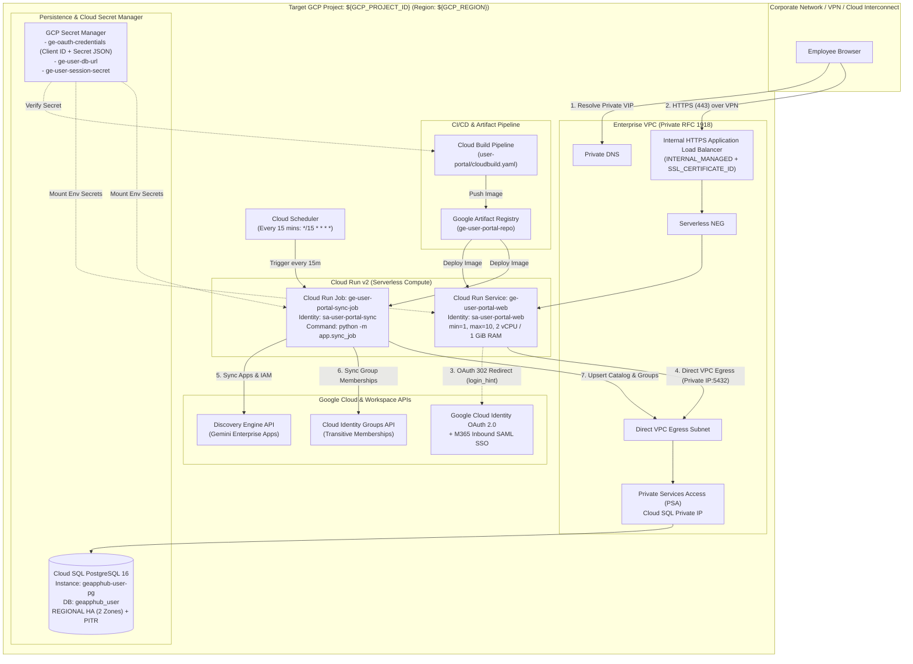

# GCP Deployment Design: Gemini AI Hub — User Portal

## 1. Executive Summary & Design Decisions

This document defines the production Google Cloud Platform (GCP) deployment architecture for the standalone **Gemini AI Hub — User Portal** (`user-portal/frontend/` + `user-portal/backend/` + `geapphub_user` database). All project identifiers (`${GCP_PROJECT_ID}`), regions (`${GCP_REGION}`), networking resources, and credentials are parameterized and managed via **Google Artifact Registry**, **Cloud Build**, **Google Cloud Secret Manager**, and **Terraform**.

| Design Dimension | Selected Architecture Decision |
| :--- | :--- |
| **1. Compute & Packaging** | **Single Cloud Run v2 Service (`ge-user-portal-web`)** built from [`user-portal/Dockerfile`](../Dockerfile), serving the compiled React 18 SPA (`user-portal/frontend/dist`) and FastAPI backend (`user-portal/backend/app/main.py`) on a single origin (`:8080`). |
| **2. Ingress & Network Perimeter** | **Terraform-Automated VPC (`vpc-ge-user-portal`), Subnets, Proxy-Only Subnet, and Regional Internal HTTPS Application Load Balancer (`INTERNAL_MANAGED`)** with a private RFC 1918 VIP. |
| **3. TLS Termination (`SSL_CERTIFICATE_ID`)** | **Regional Compute SSL Certificate (`SSL_CERTIFICATE_ID`)** created via `gcloud compute ssl-certificates create` and attached automatically by Terraform to `google_compute_region_target_https_proxy.user_portal_https_proxy` (`:443`). |
| **4. User Authentication** | **In-App Google Cloud Identity / Microsoft 365 SAML SSO** (`/api/v1/auth/google/login` with `login_hint` email redirect to Google OAuth 2.0 + PKCE and HMAC-SHA256 session tokens), with Client ID & Secret sourced from a single **GCP Secret Manager** JSON secret (`ge-oauth-credentials`). |
| **5. Database (`geapphub_user`)** | **Cloud SQL for PostgreSQL 16 (`geapphub-user-pg`)** configured with **Regional High Availability (`REGIONAL` 2-zone HA)**, `db-custom-2-8192` (2 vCPU, 8 GiB RAM), Point-in-Time Recovery (PITR), and **Private IP only** accessed via Cloud Run **Direct VPC Egress**. |
| **6. Catalog & Group Sync** | **Cloud Run v2 Job (`ge-user-portal-sync-job`)** triggered every **15 minutes** by **Cloud Scheduler** (`*/15 * * * *`), executing `python -m app.sync_job` to sync Discovery Engine applications and Cloud Identity group memberships into `geapphub_user`. |
| **7. Access & AGY License Requests** | Persisted in the **`access_requests` PostgreSQL table** (`AccessRequestRecord`) inside `geapphub_user` for Admin Console fulfillment and auditability. |
| **8. Cloud Run Sizing & Scaling** | **Warm Production Profile**: `min_instance_count = 1` (zero cold start), `max_instance_count = 10`, `2 vCPU`, `1 GiB RAM`, `max_instance_request_concurrency = 80`. |
| **9. IAM & Secret Management** | Two dedicated least-privilege service accounts (**`sa-user-portal-web`** and **`sa-user-portal-sync`**) with OAuth (`ge-oauth-credentials`), Session, and DB secrets managed in **GCP Secret Manager**. |
| **10. CI/CD & IaC Pipeline** | **Google Artifact Registry Generic Source Repo (`ge-user-portal-source`)** -> **Cloud Build (`--no-source`, `user-portal/cloudbuild.yaml`)** validates `ge-oauth-credentials` in **Cloud Secret Manager**, builds & pushes container images to **Google Artifact Registry Docker Repo (`ge-user-portal-repo`)**, and applies the **Terraform Stack (`user-portal/deploy/terraform/`)** with `SSL_CERTIFICATE_ID`. |

---

## 2. End-to-End GCP Architecture Diagram

---

## 3. IAM Least-Privilege Matrix

| Service Account | Attached Component | Granted IAM Roles | Purpose |
| :--- | :--- | :--- | :--- |
| `sa-user-portal-web@${GCP_PROJECT_ID}.iam.gserviceaccount.com` | Cloud Run Service (`ge-user-portal-web`) | `roles/cloudsql.client`, `roles/secretmanager.secretAccessor`, `roles/logging.logWriter`, `roles/monitoring.metricWriter` | Serves User Portal UI & APIs, reads/writes `geapphub_user` DB (`users`, `access_requests`), reads OAuth secrets. Has **no** write access to Discovery Engine or Terraform state. |
| `sa-user-portal-sync@${GCP_PROJECT_ID}.iam.gserviceaccount.com` | Cloud Run Job (`ge-user-portal-sync-job`) + Cloud Scheduler | `roles/cloudsql.client`, `roles/secretmanager.secretAccessor`, `roles/discoveryengine.viewer`, `roles/run.invoker`, `roles/logging.logWriter` | Periodically queries Discovery Engine engines and Cloud Identity group memberships and updates `geapphub_user`. |

---

## 4. Database Schema (`geapphub_user`)

Defined in [`user-portal/backend/app/db_models.py`](../backend/app/db_models.py):
1. `users` (`UserRecord`): Authenticated user profile, roles, and login timestamps.
2. `cloud_identity_groups` (`CloudIdentityGroupRecord`): Synced Cloud Identity groups.
3. `user_group_memberships` (`UserGroupMembershipRecord`): User-to-group membership mappings used for real-time app visibility filtering.
4. `ge_applications` (`GEApplicationRecord`): Synced Gemini Enterprise applications (`engine_id`, `display_name`, `allowed_roles`, `iam_principals`, `launch_url`).
5. `app_group_bindings` (`AppGroupBindingRecord`): Normalized engine-to-group bindings.
6. `sync_runs` (`SyncRunRecord`): Execution audit log of the 15-minute `ge-user-portal-sync-job`.
7. `access_requests` (`AccessRequestRecord`): User-submitted requests for **GE Application Access** (`APP_ACCESS`) and **AGY Licenses** (`AGY_LICENSE`).

---

## 5. Cloud Secret Manager Integration (OAuth & DB Credentials)

All sensitive authentication and database credentials are stored in **GCP Secret Manager** and consumed natively by Cloud Build, Terraform, and Cloud Run:

| Secret Manager Secret ID | Consumed By | Purpose |
| :--- | :--- | :--- |
| `ge-oauth-credentials` | `ge-user-portal-web` (`GOOGLE_OAUTH_CREDENTIALS`), `cloudbuild.yaml` | Single JSON secret storing both Google OAuth 2.0 Web Application `client_id` and `client_secret` (supports standard `client_secret.json` or `{"client_id":"...","client_secret":"..."}`). |
| `ge-user-session-secret` | `ge-user-portal-web` (`SESSION_SECRET`) | 256-bit cryptographic secret used to sign and verify HMAC-SHA256 OAuth state tokens and user session tokens. |
| `ge-user-db-url` | `ge-user-portal-web`, `ge-user-portal-sync-job` (`DATABASE_URL`) | SQLAlchemy `postgresql+psycopg://` connection string targeting the `geapphub_user` database over Cloud SQL Private IP. |
